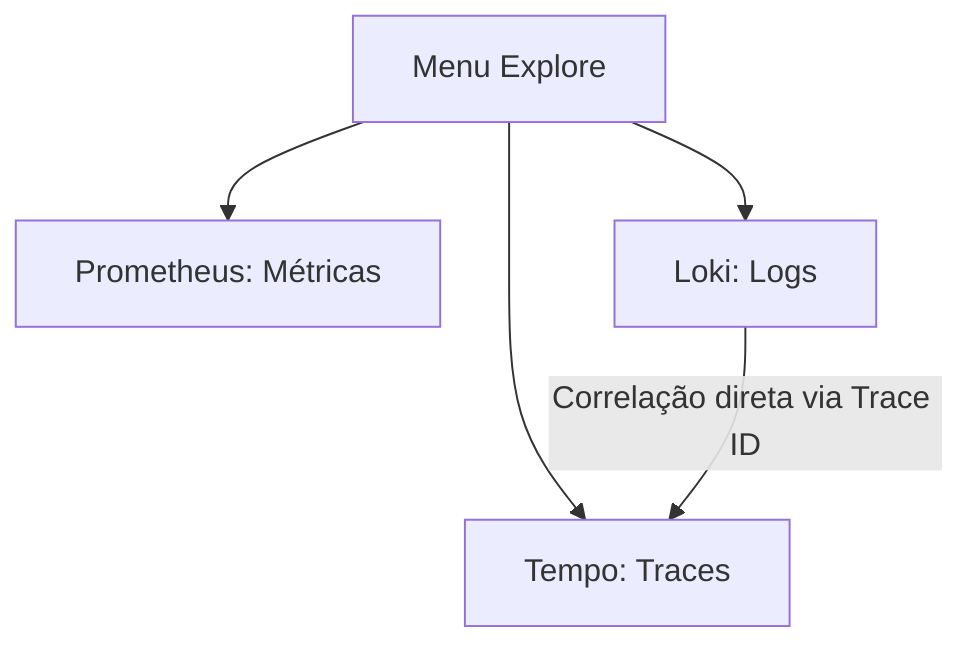

# Guia de Observabilidade: Aprendendo e Explorando a Stack LGTM no Grafana

Este guia foi desenhado para quem está começando com observabilidade em sistemas modernos. Aqui você aprenderá o que é a stack **LGTM**, os conceitos fundamentais do **OpenTelemetry** e como explorar métricas, logs e traces da sua aplicação no **Grafana**.

---

## 🧭 1. O que é a Stack LGTM?

A stack **LGTM** é um conjunto de ferramentas open-source da Grafana Labs projetado para fornecer uma solução completa de observabilidade para logs, métricas e rastreamentos (traces). Ela é composta por:

* **L (Loki):** Sistema de agregação de **Logs** focado em alta eficiência e baixo custo de armazenamento (inspirado no Prometheus).
* **G (Grafana):** A plataforma de visualização e painéis (Dashboards) onde consultamos e analisamos todos os dados.
* **T (Tempo):** Sistema de armazenamento de **Traces** (rastreamento distribuído) de alta escala, para acompanhar a jornada de uma requisição de ponta a ponta.
* **M (Mimir / Prometheus):** Banco de dados de séries temporais focado em **Métricas** numéricas rápidas e alertas.

Para conectar a nossa aplicação FastAPI a essas quatro ferramentas, usamos o **OpenTelemetry (OTel)**, um framework padrão de mercado para coletar, processar e exportar dados de telemetria.

---

## 📊 2. Conceitos: Os 3 Pilares da Observabilidade

No OpenTelemetry, trabalhamos com três pilares fundamentais: **Métricas**, **Logs** e **Traces**.

### 📈 Pilar 1: Métricas

Métricas são medidas numéricas coletadas ao longo do tempo. Elas são excelentes para responder a perguntas como: *"Quantas requisições estamos recebendo por segundo?"* ou *"Qual a latência de inferência do modelo?"*.

O OpenTelemetry possui diferentes tipos de instrumentos para registrar métricas:

1. **Counter (Contador):** Um valor numérico que **apenas aumenta** (monotônico). No Prometheus, ganha o sufixo `_total` automaticamente.
    * *Exemplo no App:* **`prediction_count`** (tipo Counter). Conta quantas predições cada modelo realizou. É rotulado com o `model` e a intenção identificada (`intent`). Como o app roda vários modelos, **um único `POST /predictions` incrementa o contador uma vez por modelo**.
2. **UpDownCounter:** Um valor numérico que pode subir ou descer (ex: uso de memória, conexões ativas).
3. **Histogram (Histograma):** Mede a duração ou tamanho de eventos e os agrupa em intervalos definidos (buckets). Permite calcular médias, taxas e percentis (p95, p99).
    * *Exemplo no App:* **`prediction_latency_seconds`** (tipo Histogram). Mede, em segundos, quanto tempo **cada modelo** levou para classificar a mensagem (só o `clf.predict`, sem contar banco de dados nem rede), rotulado com `model`. No Prometheus, gera três séries temporais:
        * `_bucket`: contagem em faixas de tempo.
        * `_sum`: a soma de todos os tempos registrados.
        * `_count`: a quantidade total de inferências registradas (por modelo).
    * A latência da **requisição HTTP inteira** é outra métrica, gerada automaticamente pelo `FastAPIInstrumentor` (ex.: `http_server_duration_milliseconds`, o nome exato varia com a versão).
4. **Gauge (Medidor):** Representa um valor instantâneo flutuante (ex: temperatura de CPU).

### 📝 Pilar 2: Logs

Logs são registros textuais de eventos ocorridos em um momento específico. A integração no arquivo `observability.py` (via `LoggingInstrumentor`) intercepta o logger padrão do Python e envia os logs automaticamente para o **Loki**, já carimbados com o `trace_id` e o `span_id` da requisição em andamento.

Atenção: só chegam ao Loki os logs que **o nosso código** emite com `logging.getLogger(__name__)`. O uvicorn configura os loggers dele para não repassar ao logger raiz, então as linhas de acesso (`"POST /predictions" 200`) aparecem só no terminal do container.

### 🕸️ Pilar 3: Traces (Rastreamento)

Um trace acompanha o ciclo de vida completo de uma requisição pelo sistema. Cada etapa de uma requisição é chamada de **Span**. Ao visualizar um trace, você vê exatamente onde a requisição passou e quanto tempo demorou em cada função ou chamada de banco de dados.

* *Exemplo no App:* o `FastAPIInstrumentor` cria automaticamente o span raiz `POST /predictions`. Dentro dele, o `service.py` cria um span **`model.predict`** para cada modelo (com o atributo `model`). Assim dá para ver, numa mesma requisição, qual modelo está pesando mais.

---

## 🧩 3. Como a telemetria está organizada no código

A ideia é separar **para onde** a telemetria vai de **o que** cada módulo mede:

| Arquivo | Responsabilidade |
| --- | --- |
| `src/shared/observability.py` | `init_opentelemetry()`: configura os providers de traces, métricas e logs e os exportadores OTLP. Não cria nenhuma métrica de negócio. |
| `src/app.py` | Chama `init_opentelemetry()` antes de criar o app e liga o `FastAPIInstrumentor` (spans e métricas HTTP de todas as rotas). |
| `src/modules/intent_classifier/service.py` | Declara as métricas do módulo (`prediction_count`, `prediction_latency_seconds`) e o span `model.predict`, e os registra dentro de `predict_all`. |
| `src/modules/intent_classifier/controller.py` | Continua sem nenhuma linha de telemetria: só recebe a requisição, chama o service e grava no banco. |

Por que as métricas ficam no `service.py`, e não no `app.py` ou no `controller.py`?
* É no `service.py` que existe o laço sobre os modelos, então é o único lugar onde dá para medir **cada** modelo separadamente.
* Um módulo novo (outro classificador, por exemplo) declara as próprias métricas no próprio service, sem precisar mexer no `app.py`.
* Os instrumentos são criados na importação do módulo com `metrics.get_meter(__name__)`. Antes do `init_opentelemetry()` eles são "proxies" que não fazem nada; quando o provider é configurado, passam a exportar. Por isso a ordem dos imports não importa.

O endereço do coletor e o nome do serviço vêm de variáveis de ambiente padrão do OpenTelemetry, e não do código:

| Variável | Para que serve | Valor no `docker-compose.yml` |
| --- | --- | --- |
| `OTEL_EXPORTER_OTLP_ENDPOINT` | Onde está o coletor OTLP (os exportadores acrescentam `/v1/traces`, `/v1/metrics` e `/v1/logs`) | `http://lgtm:4318` |
| `OTEL_SERVICE_NAME` | Nome do serviço no Grafana (vira o rótulo `service_name`) | `intent-clf` |
| `OTEL_SDK_DISABLED` | Com `true`, o `init_opentelemetry()` não configura nada | usado nos testes (`tests/conftest.py`) |

---

## 🚀 4. Executando o Ambiente

Para inicializar a aplicação e toda a stack LGTM unificada:

1. **Suba os containers via Docker Compose:**
    Na raiz do projeto, rode:

    ```bash
    docker compose up --build
    ```

2. **Acesse o Grafana:**
    No seu navegador, entre em: [http://localhost:3000](http://localhost:3000)
    * **Usuário:** `admin`
    * **Senha:** `admin`

3. **(Opcional) Rodando a API fora do compose:**
    Se você subir só o `lgtm` e rodar a API direto na sua máquina, aponte para a porta exposta no host:

    ```bash
    docker compose up -d lgtm
    export OTEL_EXPORTER_OTLP_ENDPOINT=http://localhost:4318
    export OTEL_SERVICE_NAME=intent-clf
    uvicorn src.app:app --port 8000
    ```

    Para rodar sem telemetria nenhuma, use `export OTEL_SDK_DISABLED=true`.

> [!NOTE]
> As métricas são exportadas em lote a cada 60 segundos (padrão do `PeriodicExportingMetricReader`). Se o gráfico estiver vazio logo depois das primeiras requisições, espere um minuto.

---

## ⚡ 5. Gerando Dados de Teste

Para ver os gráficos funcionando, precisamos enviar requisições para a API de predição (`POST /predictions`, com a mensagem no corpo em JSON):

```bash
# Execute estas requisições no seu terminal algumas vezes:
curl -X POST 'http://localhost:8000/predictions' \
  -H 'Content-Type: application/json' \
  -d '{"nome": "Ana", "text": "Quero cancelar a minha assinatura"}'

curl -X POST 'http://localhost:8000/predictions' \
  -H 'Content-Type: application/json' \
  -d '{"nome": "Bruno", "text": "Estou muito confuso com esse modelo"}'
```

Ou, para gerar volume rapidamente:

```bash
for i in $(seq 1 30); do
  curl -s -X POST 'http://localhost:8000/predictions' \
    -H 'Content-Type: application/json' \
    -d '{"nome": "Teste", "text": "não entendi a explicação"}' > /dev/null
done
```

---

## 🔍 6. Explorando no Grafana

No menu lateral esquerdo do Grafana, clique em **Explore** (ícone de bússola 🧭).



### A. Consultando Métricas (Prometheus)

Selecione o data source **Prometheus** no topo esquerdo do Explore.

1. **Taxa de predições por segundo por modelo e intenção:**

    ```promql
    sum(rate(prediction_count_total[5m])) by (model, intent)
    ```

2. **Tempo médio de inferência do modelo:**

    ```promql
    sum(rate(prediction_latency_seconds_sum[5m])) by (model) / sum(rate(prediction_latency_seconds_count[5m])) by (model)
    ```

3. **Percentil 95 (p95) da latência (95% das inferências são mais rápidas que este valor):**

    ```promql
    histogram_quantile(0.95, sum(rate(prediction_latency_seconds_bucket[5m])) by (le, model))
    ```

### B. Consultando Logs (Loki)

Selecione o data source **Loki** no Explore.

1. **Ver todos os logs da aplicação:**

    ```logql
    {service_name="intent-clf"}
    ```

2. **Filtrar apenas por erros** (o nível do log chega como metadado, não dentro do texto):

    ```logql
    {service_name="intent-clf"} | severity_text="ERROR"
    ```

3. **Buscar um trecho de texto nas mensagens:**

    ```logql
    {service_name="intent-clf"} |= "predictions"
    ```

> [!TIP]
> **Correlação Logs 🔗 Traces:**
> Expanda qualquer linha de log listada. Devido à instrumentação do OTel, você verá metadados como `trace_id`. O Grafana disponibiliza um botão azul escrito **Tempo** ao lado do ID. Ao clicar nele, você abre o trace exato da requisição correspondente àquela linha de log!

### C. Consultando Rastreamento (Tempo)

Selecione o data source **Tempo** no Explore.

1. Mude a aba de consulta de *Query* para **Search**.
2. No campo **Service Name**, selecione `intent-clf`.
3. Clique em **Run Query** no topo direito.
4. Clique em um dos traces `POST /predictions` na lista de resultados para visualizar a cascata de spans: o span da rota e, dentro dele, um span `model.predict` por modelo, com o atributo `model`.

Também dá para buscar direto pelos spans de um modelo com TraceQL (aba **TraceQL**):

```traceql
{ resource.service.name = "intent-clf" && name = "model.predict" && span.model = "NOME_DO_MODELO" }
```

---

## 📝 7. Mini-changelog: o que foi preciso para integrar a observabilidade

*Integração feita em novembro de 2026, partindo da versão que existia no `app.py` monolítico do repositório `mlops-2026-1` e adaptando para a arquitetura modular deste repositório.*

### O que mudou, arquivo por arquivo

| Arquivo | Mudança | Por quê |
| --- | --- | --- |
| `requirements.txt` | Adicionados `opentelemetry-api`, `-sdk`, `-exporter-otlp-proto-http` (1.45.2) e `-instrumentation`, `-instrumentation-fastapi`, `-instrumentation-logging` (0.66b2). | Sem eles o container quebra no import. Os pacotes `instrumentation-*` (0.xxb0) precisam ser da mesma leva do SDK (1.xx). |
| `src/shared/observability.py` (novo) | `init_opentelemetry()` configura os providers de traces, métricas e logs com exportadores OTLP/HTTP. Lê endpoint e nome do serviço de variáveis de ambiente e não faz nada com `OTEL_SDK_DISABLED=true`. | Centraliza o *para onde* a telemetria vai, sem conhecer nenhuma regra de negócio. |
| `src/app.py` | Chama `init_opentelemetry()` e aplica `FastAPIInstrumentor.instrument_app(app)`. | Liga a telemetria uma vez e ganha, sem escrever código, um span e métricas HTTP para cada rota. |
| `src/modules/intent_classifier/service.py` | Declara `prediction_count` (Counter) e `prediction_latency_seconds` (Histogram); em `predict_all`, cria um span `model.predict` por modelo e registra as métricas. | É onde existe o laço sobre os modelos, logo o único lugar que mede cada modelo separadamente. |
| `src/modules/intent_classifier/controller.py` | `logger.info` na entrada da rota, uma linha por modelo com a intenção prevista, `logger.exception` se a gravação no MongoDB falhar, e log na consulta `GET /predictions`. | Sem logs emitidos pelo nosso código, o Loki fica vazio (o uvicorn não repassa os logs de acesso). Os logs **não** incluem o texto nem o nome do aluno, só o tamanho da mensagem. |
| `tests/conftest.py` | `OTEL_SDK_DISABLED=true` antes dos imports. | Os testes não tentam exportar para um coletor que não existe no CI e não dependem do LGTM. |
| `docker-compose.yml` | Novo serviço `lgtm` (`grafana/otel-lgtm`, portas 3000, 4317 e 4318); a API recebe `OTEL_EXPORTER_OTLP_ENDPOINT` e `OTEL_SERVICE_NAME` e depende do `lgtm`. | Sobe a stack inteira com um `docker compose up`. A porta 4318 exposta permite rodar a API fora do compose. |

### O que mudou em relação à versão antiga (`mlops-2026-1`)

Não foi só mover código de lugar. Alguns problemas da versão antiga apareceram na migração:

1. **A latência "por modelo" era a da requisição inteira.** O código antigo media o tempo de todos os modelos juntos e registrava esse mesmo valor para cada um. Agora cada modelo é cronometrado isoladamente, em torno do `clf.predict`.
2. **Métricas criadas em dois lugares.** O `observability.py` antigo criava as métricas como variáveis globais e o `app.py` criava de novo. Além de duplicar instrumentos, a global seria `None` no momento do import. Agora elas existem só no `service.py`, criadas com `metrics.get_meter(__name__)`, que funciona antes mesmo do `init_opentelemetry()`.
3. **Endpoint fixo no código** (`http://lgtm:4318`). Só funcionava dentro do compose. Agora vem de `OTEL_EXPORTER_OTLP_ENDPOINT`, que os exportadores leem sozinhos.
4. **Logs duplicados no Loki.** Nas versões atuais do OpenTelemetry, o `LoggingInstrumentor` já instala o handler de envio. O `LoggingHandler` adicionado manualmente (e hoje obsoleto) fazia cada log chegar duas vezes. Ele foi removido.
5. **Middleware de log de requisições não foi portado.** O `FastAPIInstrumentor` já cobre o que ele fazia, e o middleware antigo registrava todos os headers, inclusive `Authorization`.
6. **Logger interno do OpenTelemetry em DEBUG** deixou de ser forçado, porque poluía a saída da aplicação.

### O que a observabilidade nos permite agora

* **Responder "o serviço está saudável?"** com as métricas HTTP automáticas: volume de requisições, taxa de erros e latência de cada rota.
* **Comparar os modelos em produção** lado a lado: quantas predições cada um fez, quanto tempo cada um leva (média e p95) e como as intenções previstas se distribuem (`prediction_count_total` por `model` e `intent`).
* **Investigar uma requisição lenta ou com erro de ponta a ponta:** do log no Loki ao trace no Tempo pelo `trace_id`, vendo se o tempo foi gasto em um modelo específico ou fora dele (por exemplo, no MongoDB).
* **Ver falhas de gravação no banco** como logs de nível `ERROR`, com traceback, filtráveis por `severity_text="ERROR"`.
* **Manter a arquitetura modular:** um módulo novo declara as próprias métricas no próprio service. O `app.py` e o `observability.py` não mudam.

### Limitações e próximos passos

* **Métricas operacionais, não de qualidade do modelo.** Hoje sabemos *se* e *quão rápido* os modelos respondem, não *quão bem*. Um próximo passo natural para MLOps é registrar a confiança da intenção prevista (a maior probabilidade em `probs`) num histograma por modelo, para observar deriva (*drift*): uma queda gradual de confiança costuma ser o primeiro sinal de que as mensagens mudaram.
* **A imagem `grafana/otel-lgtm:latest` não está fixada.** Para aulas reprodutíveis, fixe uma versão.
* **Sem volume persistente para o LGTM.** Recriar o container apaga métricas, logs e traces. Para o laboratório, isso é aceitável.
* **O `depends_on` não espera o LGTM ficar pronto.** As primeiras exportações podem falhar e são reenviadas automaticamente. É normal ver avisos de exportação nos primeiros segundos.
* **Sem dashboards nem alertas provisionados.** Tudo é explorado manualmente pelo *Explore*. Um dashboard versionado e um alerta (por exemplo, p95 de latência acima de um limite) seriam o passo seguinte.
* **Sem instrumentação automática do MongoDB.** O tempo do `insert_one` aparece só como a diferença entre o span da rota e os spans `model.predict`. O pacote `opentelemetry-instrumentation-pymongo` criaria spans próprios para o banco.
